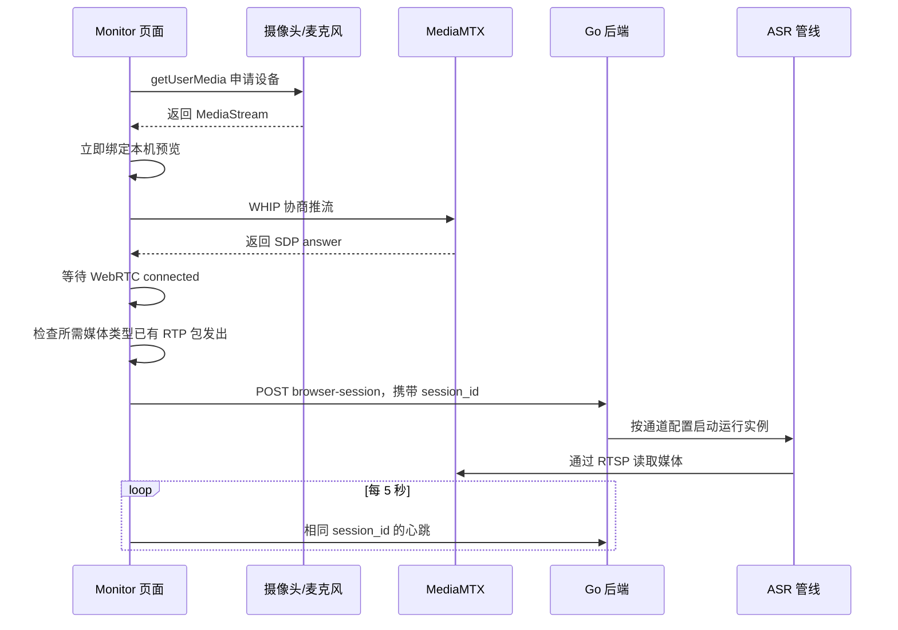

# Monitor 浏览器音视频通道刷新恢复：改动逻辑说明

本文解释这次针对“刷新 Monitor 后，画面和声音需要等待几秒，后台 ASR 出现 RTSP 404”的修改。内容以当前代码为准，范围仅限这次浏览器采集生命周期优化。

## 1. 先说明问题的本质

对于浏览器摄像头和麦克风通道，Monitor 同时承担了两种职责：

1. 调用浏览器设备接口，采集摄像头和麦克风，并向 MediaMTX 推流。
2. 展示画面、音频可视化和后端识别结果。

因此，刷新 Monitor 实际上也会关闭正在推流的页面。旧页面的摄像头轨道、麦克风轨道、WebRTC 连接都会结束，新页面需要重新申请设备并重新建立连接。

后端读取的是 MediaMTX 上的 RTSP 地址，例如：

```text
rtsp://localhost:8554/livecamera
```

这个地址不是一个永远存在的视频文件。只有对应路径上有发布者时，MediaMTX 才能提供媒体。刷新造成发布者短暂消失，后端此时发起 RTSP DESCRIBE，就可能收到 `404 Not Found`。

所以，这条报错通常表示“此刻该路径没有流”，不能仅据此判断通道配置错了或摄像头坏了。

## 2. 原来的等待由哪些环节组成

浏览器通道展示远端画面，需要经过这样的链路：

```text
申请摄像头/麦克风
  → 创建 WebRTC 推流连接
  → MediaMTX 接收媒体
  → 页面再从 MediaMTX 拉流
  → 播放器显示画面和声音
```

后端 ASR 则走另一条链路：

```text
MediaMTX 接收媒体
  → FFmpeg 通过 RTSP 读取音频
  → 音频发送给 ASR 服务
  → 识别结果返回页面
```

刷新期间，这几条链路的启动和停止没有天然的同步顺序。此次修改重点处理以下问题：

- 通道查询返回一个新对象，也可能让采集副作用重新运行，造成不必要的设备重启。
- 推流 HTTP 协商成功，不代表已经实际发送音视频；此时启动 ASR 仍然可能过早。
- 旧页面退出请求可能晚于新页面启动请求到达，误把新会话关闭。
- 页面在异步申请设备或协商连接时退出，未完成的操作需要能够取消或回收。
- 只为看本机摄像头画面，也要等待推流再拉流，增加了预览恢复环节。

## 3. 修改后的整体流程



这里有两个不同的“就绪”：

- **本机预览就绪**：已经取得设备流，可以显示本机画面。
- **推流就绪**：WebRTC 已连接，并且所有需要的媒体类型都已发出 RTP 包，随后后端会话登记成功。

看到本机画面不等于后端一定收到媒体。因此页面用“本机预览 · 推流连接中 / 已推流”区分这两种状态。

## 4. 采集配置变化时才重建设备

对应文件：`web/src/lib/browser-capture-config.ts`、`web/src/hooks/use-browser-publisher.ts`。

新增 `browserCaptureKey(channel)`，从通道中提取真正影响浏览器采集的字段，序列化成稳定的字符串，作为 React effect 的依赖。

参与判断的内容包括：

- 通道 ID 和 MediaMTX 路径。
- 通道是否启用，以及启用的浏览器来源。
- 摄像头设备 ID。
- 麦克风设备 ID 列表及其顺序。

通道名称、更新时间、翻译开关等内容不进入这个采集配置。即使查询结果变成一个新对象，只要采集配置不变，就不会重新打开摄像头和麦克风。

这条规则只约束前端设备采集。后端是否因为 ASR 等配置变化而调整运行实例，仍由后端自己的逻辑决定。

## 5. 本机预览为什么更早出现

对应文件：`web/src/pages/monitor-page.tsx` 中的 `VideoPanel` 和 `LocalPreview`。

取得摄像头流后，页面直接执行：

```ts
video.srcObject = stream
```

同一个流继续用于向 MediaMTX 推送，所以本机预览不用等待“先推到服务器，再拉回浏览器”。网络推流尚在连接时，本机画面也可以先出现。

几个需要区分的行为：

- 本机预览展示的是本地设备流，不能用于证明远端播放、录制和 ASR 已正常工作。
- 本机预览没有强制静音，保留了之前要求的默认声音开启行为；浏览器仍可能限制有声自动播放，需要用户操作播放器。
- 只有主流中包含麦克风时，该预览才有对应声音。额外音频来源仍按各自路径处理。
- 预览组件卸载只暂停视频并解除 `srcObject`；真正停止设备轨道由采集 hook 统一负责，避免播放器重挂载误停推流。
- 没有本机预览的来源，仍使用 MediaMTX 播放器；浏览器发布尚未就绪时先展示等待状态。

## 6. 怎样判断可以启动后端 ASR

对应文件：`web/src/lib/browser-publisher.ts`。

`BrowserPublisher.start()` 现在依次等待：

1. ICE 候选收集完成。
2. WHIP POST 请求成功，得到 SDP answer。
3. `RTCPeerConnection.connectionState` 进入 `connected`。
4. `getStats()` 中，对当前流包含的每一种媒体类型，都出现 `outbound-rtp` 且 `packetsSent > 0`。

例如，一个流同时有视频和音频，就需要看到视频和音频都已发包。只看到 HTTP 成功，或只看到视频开始发送，都不算这个流完成就绪检查。

所有需要发布的流都通过检查后，前端才调用后端 `browser-session` 接口。

**这个检查确认的是浏览器已经发包，并不是 MediaMTX 的 RTSP 可读性探测。** 它能减少过早启动 ASR 的窗口，但不能保证任何情况下都完全没有瞬时 404；网络中断、MediaMTX 重启和路径异常仍可能使读取失败。

页面也使用同一个状态：浏览器推流未就绪时，不启动音频卡片的远端拉流，开始录制按钮保持不可用，避免明知流尚未准备好就发起读取。

## 7. session_id 如何防止旧页面关闭新会话

对应文件：`web/src/lib/api.ts`、`server/internal/httpapi/server.go`、`server/internal/channelruntime/manager.go`。

每次发布尝试都会生成新的随机 `session_id`。这个 ID 表示一次发布尝试，不是用户登录凭证，也不是 MediaMTX 返回的 WHIP 资源地址。

登记和心跳请求：

```http
POST /api/channels/{id}/browser-session
Content-Type: application/json

{"session_id":"new-session"}
```

退出请求：

```http
DELETE /api/channels/{id}/browser-session?session_id=new-session
```

后端同时保存最近心跳时间和当前会话 ID。最关键的规则是：**DELETE 只能停止与当前 ID 相同的会话。**

刷新可能发生这样的请求乱序：

| 顺序 | 请求 | 后端处理 |
| --- | --- | --- |
| 1 | 旧页面 A 正在发布 | 当前会话为 A |
| 2 | 新页面 B 发布就绪，登记 B | 当前会话切换为 B |
| 3 | 旧页面 A 的退出请求迟到 | ID 不匹配，忽略 |
| 4 | B 发心跳 | 更新时间，继续使用 B |

如果新会话接替了仍登记的旧会话，后端会取消旧运行实例并创建新实例，让新发布者不再继承旧 ASR 管线的重试等待。同一个 ID 的普通心跳不会仅因心跳本身重建运行实例。

这个机制解决的是旧退出请求误关新会话。它不是完整的多标签页发布仲裁协议，也没有为所有乱序心跳建立版本排序；不应据此认为多个标签页可以任意同时发布同一个路径。

## 8. 连接失败后如何恢复

对应文件：`web/src/hooks/use-browser-publisher.ts`。

设备采集和网络发布现在分开管理：

```text
设备采集成功
  → 保留 MediaStream
  → 尝试发布
      → 成功：登记后端会话，定期心跳
      → 失败：关闭这次连接，稍后用同一 MediaStream 重试
```

这样在页面仍然存活、只是网络连接失败时，无需每次重连都重新打开摄像头。本机预览也可以继续显示。

当前等待参数如下，都是超时上限或重试间隔，不代表每次必须等待这么久：

| 环节 | 参数 |
| --- | --- |
| ICE 收集 | 最长 5 秒 |
| WHIP POST | 最长 10 秒 |
| 等待 WebRTC connected | 最长 10 秒 |
| 等待各媒体类型实际发包 | 最长 5 秒，每 50 毫秒检查 |
| `disconnected` 状态观察期 | 1 秒，恢复连接则取消处理 |
| 确认断连后再次尝试发布 | 约 500 毫秒后 |
| 一次发布尝试失败后重试 | 约 1 秒后 |
| 后端会话心跳 | 每 5 秒 |
| 后端心跳有效期 | 15 秒，周期检查时回收 |
| WHIP 资源 DELETE | 最长 2 秒 |

摄像头权限拒绝、设备不可用等采集错误会显示错误并释放已取得的轨道，不进入网络发布重试循环，避免不断重复设备申请。

## 9. 刷新、切换通道时如何释放资源

这次补充了异步操作中的清理逻辑：

- 页面退出或采集配置变化时，取消当前发布尝试，停止心跳和重试定时器。
- 用 `AbortController` 取消尚未结束的连接流程；相关 WebRTC peer 会关闭。
- 如果设备申请在页面退出后才返回，立即停止新返回的轨道，避免摄像头残留占用。
- 保存 WHIP 响应的 `Location`，结束发布时 DELETE 对应 MediaMTX 资源。
- 后端会话退出请求和 WHIP DELETE 使用 `keepalive`，提高页面离开时请求送出的机会。
- 如果协商响应在取消后才到达，也尝试清理其返回的 WHIP 资源。
- `stop()` 可重复调用，避免多处清理重复操作资源。

页面监听 `pagehide` 主动释放资源；如果从浏览器前进/后退缓存恢复，使用重新加载重新初始化采集。初始采集通过微任务启动并检查是否已释放，也减少 React 开发模式 StrictMode 短暂挂载造成的重复申请。

`keepalive` 不是送达保证。浏览器崩溃、直接断网等情况下，后端通过 15 秒心跳有效期兜底，并在运行管理器后续检查时回收会话，而不是承诺恰好第 15 秒清理。

## 10. 文件与职责对照

| 文件 | 这次改动的职责 |
| --- | --- |
| `web/src/lib/browser-capture-config.ts` | 提取稳定采集配置，避免无关数据变化重启设备 |
| `web/src/hooks/use-browser-publisher.ts` | 管理设备、预览、发布尝试、重试、心跳和退出 |
| `web/src/lib/browser-publisher.ts` | WHIP 协商、连接与 RTP 就绪判断、取消和资源释放 |
| `web/src/lib/api.ts` | 给浏览器会话请求增加 ID、取消信号和退出 keepalive |
| `web/src/pages/monitor-page.tsx` | 本机预览、状态提示、录制及音频拉流的就绪限制 |
| `server/internal/httpapi/server.go` | 接收并传递 session_id |
| `server/internal/channelruntime/manager.go` | 记录当前会话、拒绝旧退出请求、切换运行实例及过期回收 |
| `web/scripts/test-browser-publisher.mjs` | 推流协议时序、取消和稳定配置回归测试 |
| `server/internal/channelruntime/browser_session_test.go` | 会话切换、旧退出请求、心跳和过期回归测试 |
| `server/README.md` | 补充浏览器采集生命周期说明 |

## 11. 验证做到了什么

此次实现时已完成前端 TypeScript 检查、改动文件的 ESLint 检查、生产构建，以及后端 `go test ./...`。

前端三组脚本合计 13 项测试通过，其中这次新增的 5 项覆盖：

1. HTTP 协商成功后仍等待 WebRTC 连接。
2. ICE 协商期间取消会关闭未完成的 peer。
3. connected 后仍等待实际 RTP 发包。
4. 发布 HTTP 失败会释放 peer。
5. 无关通道字段变化不会改变采集配置，而更换设备会改变配置。

后端新增测试覆盖：新会话接替旧会话、旧页面或无 ID 的迟到退出请求不能关闭当前带 ID 的会话、同会话心跳不重启实例，以及心跳过期回收。

这些测试验证的是协议和会话逻辑。前端使用模拟设备及连接状态，并未测量真实摄像头刷新后多少毫秒恢复，也没有证明特定浏览器、网络和设备组合一定零报错。

建议实机观察以下现象：

- 刷新后先显示本机预览，再变为“已推流”，随后恢复识别。
- 修改翻译等无关采集配置时，摄像头不会反复关闭、打开。
- 推流网络失败时，本机预览仍在，连接自动重试。
- 快速刷新后，新会话不会被旧页面的退出请求关闭。
- 浏览器发布未就绪时，不能提前开始录制。

## 12. 仍然存在的限制与下一步选择

这次减少了恢复过程中不必要的设备重启、往返拉流等待和会话竞态，**没有改变“Monitor 页面拥有采集推流”这一架构**。

因此，整页刷新仍会关闭设备和推流。新页面仍需重新采集、协商，后台录制和 ASR 仍可能短暂断流。仅凭这些修改，不能承诺录制文件或识别内容连续无缺口。

如果业务要求“任意刷新 Monitor，录像和识别都不中断”，需要把采集与 Monitor 生命周期分开，例如：

- 独立采集页面：持续持有设备并发布，Monitor 只负责观看和控制；采集页面仍必须保持运行。
- 本地常驻采集程序或独立推流设备：持续向 MediaMTX 发布，Monitor 完全作为观看端。

这是后续架构调整，尚未包含在本次改动中。
